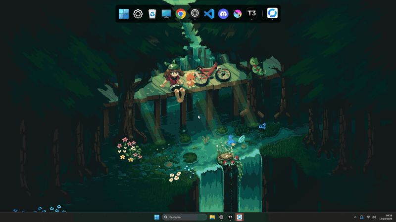

> [!NOTE]
> **This is a personal fork.** It is based on [Cedro-Software/cedro-modern-dock](https://github.com/Cedro-Software/cedro-modern-dock);
> all credit for the dock itself goes to its authors. The changes listed below were made in this
> fork only and are **not** part of the official releases.

## What this fork adds

### Taskbar-style context menu
- **Right click on any dock item** shows the app's jump list, as on the Windows 11 taskbar (VS Code
  recent folders, Terminal profiles, Chrome recently closed tabs, Explorer frequent folders,
  WhatsApp pinned chats...), followed by the dock's own actions: launch, run as administrator, open
  file location, pin/unpin and close window(s).
- The menu is **styled like the dock**: its color and transparency, Windows 11 acrylic and rounded
  corners. A new *acrylic intensity* slider in Settings controls how much of the background shows
  through.

### Taskbar-like behavior
- **Left click on a running app** brings its window forward, minimizes it when it is already active,
  or cycles through its windows when it has several.
- **Middle click** on a dock icon starts a new instance; on a preview thumbnail it closes that window.
- Windows are grouped by AppUserModelID, like the taskbar does, so apps started through an alias or a
  launcher (`wt.exe`) show as running and no longer appear twice.
- Activating a snapped or maximized window no longer restores it to its floating size.

### Positioning
- New **"keep maximized windows above the dock"** setting (on by default): the dock reserves its strip
  of the screen, so maximized windows stop above it.
- Static positioning sticks to the monitor the dock was last on, and the saved position no longer
  drifts when a monitor sits above or to the left of the primary one.

### Windows 11 style clock and calendar
- **Clock** at the end of the dock, after the open apps: 24-hour time over the date (DD/MM/YYYY).
  Hovering it shows the full date.
- **Clicking the clock opens a month calendar** like the taskbar's: today marked with the system
  accent color, a ring on the day you click, and ▲▼ or the mouse wheel to browse months with a quick
  slide. Clicking the month title opens a **year view** to jump to any month; clicking the date on top
  returns to today.
- It shares the context menu's look and acrylic slider, and never spans more than half the dock.
  Day and month names and the first day of the week follow the Windows regional settings.

### Taskbar badges
- Dock icons show the **badges apps put on their taskbar buttons**, like Windows' "Show badges on
  taskbar apps": the overlay icon of desktop apps (Outlook, Teams, Slack, Discord...) and the unread
  count or glyph of packaged apps (WhatsApp, Mail...). Hovering the icon shows the badge's text
  ("5 unread messages"). A new setting turns them off.
- Overlays are read by taking over the taskbar's `TaskbandHWND` property and forwarding every
  message to Explorer, so the Windows taskbar keeps its overlays, progress bars and thumbnail
  buttons; the property is handed back when the dock exits or the setting is turned off. Badges of
  packaged apps are read from the notification database through Windows' own `winsqlite3.dll`.
- Known limit: an app that set up its taskbar connection *before* the dock started and keeps
  reusing it only reaches Explorer, so its overlay shows on the dock after the app restarts.

### Installing this fork
The official installer below does not include these changes. Build this fork from source instead
(requires the .NET 9 SDK or later):

```powershell
cd dotnet
dotnet publish src/CedroModernDock/CedroModernDock.csproj -c Release -r win-x64 --self-contained true -p:PublishSingleFile=true -o publish
```

Then run `publish/CedroModernDock.exe`, or close the dock and copy it over the installed
`C:\Program Files (x86)\CedroModernDock\CedroModernDock.exe`. `dotnet/installer/build.ps1` builds an
MSI instead (requires [WiX](https://wixtoolset.org/)).

---

*The rest of this README is the original project's.*


> Follow @TeiuAlligator on X to stay tuned for new features and updates!


> ## How To Install (official version, without this fork's changes)
> 1. Go to [Releases](https://github.com/arthurdeka/cedro-modern-dock/releases):
> 2. Download the latest `CedroModernDock-1.2.0-x64.msi` file
> 3. Execute and install
<br>

## What's new in v1.2

- **Live window previews:** Hover a running app to see its open windows in real time, click one to bring it forward.
- **Running apps you haven't pinned:** Apps currently open but not pinned show up on the dock now.
- **Customize your icons:** iOS-style color tint with 12 presets or pick your own color.
- **Drag to reorder:** Now you can rearrange your dock shortcuts right in the Settings list by dragging them around.
- **Vertical dock:** Arrange the dock vertically on either side of the screen.
- **Updates that keep your setup:** - Upgrading to a new version replaces the app but keeps your shortcuts and settings.
- **Long-awaited feature:** Now CTRL + D does NOT minimizes the Dock anymore. It remains on the Desktop.
<br>

## Supported Languages

- 🇺🇸  English
- 🇧🇷 Portuguese (Brazil)
- 🇪🇸 Spanish
- 🇫🇷 French
- 🇩🇪 German
- 🇯🇵 Japanese
- 🇨🇳 Chinese (Simplified)
- 🇹🇼 Chinese (Traditional)
- 🇮🇳 Hindi
- 🇸🇦 Arabic
- 🇧🇩 Bengali
- 🇷🇺 Russian
- 🇵🇰 Urdu
- 🇮🇩 Indonesian
- 🇳🇬 Nigerian Pidgin
- 🇮🇳 Marathi
- 🇮🇳 Telugu
- 🇹🇷 Turkish
- 🇮🇳 Tamil
- 🇭🇰 Cantonese
- 🇻🇳 Vietnamese
<br>

<!-- BUILT WITH -->
## Built With

* 
* 
<br>

<!-- GETTING STARTED -->
## How To Contribute
> Only for those who wish to contribute in the project's coding, none of this is required for you to do if you [just want to download it](https://github.com/arthurdeka/cedro-modern-dock/releases)
### Understand the project architecture:

The project follows a layered architecture:

- `CedroModernDock.Core`: Domain models, Application services, and i18n (portable, no OS deps)
- `CedroModernDock.Infrastructure.Windows`: Windows-specific adapters (Win32 interop, icon extraction, JSON persistence, registry auto-start, tray icon)
- `CedroModernDock`: Avalonia UI (dock view, settings window, view models, view locators)
- `CedroModernDock.Tests`: xUnit test suite

`App.axaml.cs` is responsible for composing these dependencies and injecting them into the view models.

<!-- PREREQUISITES -->
### Prerequisites

Before you begin, ensure you have the following installed on your system: (required only for development)

- **An IDE** (Visual Studio 2022 or Rider recommended).
- **.NET 9 SDK** (or .NET 10 SDK).
- **Git** for cloning the repository.

<br>

### How To Run Locally

1. Clone the repository
2. Before running, make sure to install all the dependencies (`dotnet restore`)
3. Run `dotnet run --project src/CedroModernDock` to run the program
4. Make desired changes
5. Commit your changes
6. Open a pull request

<br>

### How To `COMPILE` Locally

1. Clone the repository
2. Install all dependencies (`dotnet restore`)
3. Run `dotnet build src/CedroModernDock -c Release` on the terminal
4. The `.exe` file will be available at `src/CedroModernDock/bin/Release/net9.0-windows/CedroModernDock.exe`

<br>
